
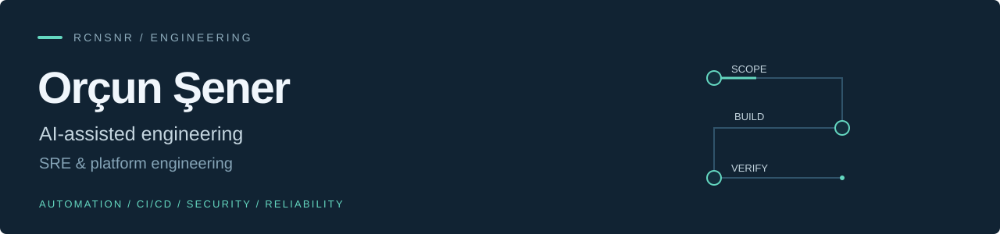

I build practical software and automation with a reliability-first approach. My background spans <strong>Linux, containers, observability, and incident response</strong>; my public work connects APIs and web interfaces with tests and documented delivery decisions.

<a href="#selected-work">Selected work</a> · <a href="#ai-assisted-delivery">AI-assisted delivery</a> · <a href="#security-and-reliability">Security &amp; reliability</a> · <a href="https://www.linkedin.com/in/orcunsener">LinkedIn</a>

<h2 id="selected-work">Selected work</h2>

<table>
<tr>
<td width="50%" valign="top">
<h3><a href="https://github.com/rcnsnr/Agentic-Infra-Notes">Agentic Infra Notes</a></h3>

RESEARCH &amp; DOCUMENTATION

Sanitized agent-workflow architecture, local LLM experiments, and operational safety notes. Public documentation, not private implementation code.

<a href="https://github.com/rcnsnr/Agentic-Infra-Notes">Research notes</a> · <a href="https://github.com/rcnsnr/Agentic-Infra-Notes/blob/main/case-studies/botaio-n8n-finetuning-lab.md">GX10 / GB10 lab</a>

</td>
<td width="50%" valign="top">
<h3><a href="https://github.com/rcnsnr/job-search-workflow">Job Search Workflow</a></h3>

LOCAL-FIRST · ALPHA

Python CLI, FastAPI dashboard, browser extension, and user-controlled AI workflows. Source-available for noncommercial use.

<a href="https://github.com/rcnsnr/job-search-workflow/blob/main/dashboard/server.py">Code</a> · <a href="https://github.com/rcnsnr/job-search-workflow/blob/main/tests/test_dashboard.py">Tests</a> · <a href="https://github.com/rcnsnr/job-search-workflow/blob/main/.github/workflows/ci.yml">Privacy + CI</a>

</td>
</tr>
<tr>
<td width="50%" valign="top">
<h3><a href="https://github.com/rcnsnr/pptx-brand-reviewer">PPTX Brand Reviewer</a></h3>

EXPLAINABLE REVIEW

FastAPI + Next.js application for slide-level brand findings and human review. Deterministic checks; no AI runtime dependency.

<a href="https://github.com/rcnsnr/pptx-brand-reviewer/blob/main/apps/web/components/review-workspace.tsx">Review UI</a> · <a href="https://github.com/rcnsnr/pptx-brand-reviewer/blob/main/apps/api/src/brand_reviewer_api/services/rules.py">Rules</a> · <a href="https://github.com/rcnsnr/pptx-brand-reviewer/blob/main/apps/api/tests/test_rules.py">Tests</a>

</td>
<td width="50%" valign="top">
<h3><a href="https://github.com/rcnsnr/lovie-afb-assignment">Payment Request Demo</a></h3>

SIMULATED PAYMENTS

Next.js, TypeScript, Prisma, and PostgreSQL assignment with server-enforced lifecycle rules and Playwright evidence. Payments are simulated.

<a href="https://github.com/rcnsnr/lovie-afb-assignment/blob/main/prisma/schema.prisma">Data model</a> · <a href="https://github.com/rcnsnr/lovie-afb-assignment/blob/main/e2e/pay-simulation.spec.ts">Tests</a> · <a href="https://github.com/rcnsnr/lovie-afb-assignment/blob/main/docs/AI_PROCESS.md">AI delivery log</a>

</td>
</tr>
</table>

<h2 id="ai-assisted-delivery">AI-assisted delivery</h2>

Selected tools from implementation work, lab experiments, and technical exploration.

<strong>AI-assisted development.</strong> Scoped implementation, debugging, and review, from coding assistants to Python/CPython, Rust, C++, and Go.

&nbsp;&nbsp;&nbsp;&nbsp;&nbsp;
&nbsp;&nbsp;&nbsp;&nbsp;&nbsp;
<a href="https://devin.ai/" title="Devin"><picture><source media="(prefers-color-scheme: dark)" srcset="assets/refined/devin-dark.svg" /></picture></a>&nbsp;&nbsp;&nbsp;&nbsp;&nbsp;
<a href="https://opencode.ai/" title="OpenCode"></a>&nbsp;&nbsp;&nbsp;&nbsp;&nbsp;
&nbsp;&nbsp;&nbsp;&nbsp;&nbsp;
&nbsp;&nbsp;&nbsp;&nbsp;&nbsp;
<a href="https://isocpp.org/" title="C++">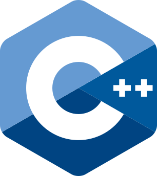</a>&nbsp;&nbsp;&nbsp;&nbsp;&nbsp;

<strong>Local AI &amp; model optimization.</strong> GX10 / GB10 Grace Blackwell lab work spans serving, fine-tuning, and memory trade-offs. The technical scope includes Transformers, PEFT, QLoRA, and NVFP4.

&nbsp;&nbsp;&nbsp;&nbsp;&nbsp;
<a href="https://github.com/sgl-project/sglang" title="SGLang">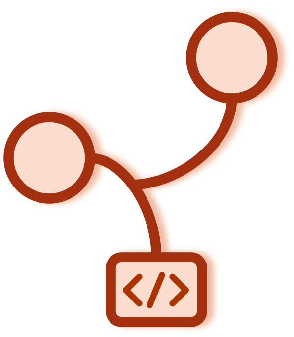</a>&nbsp;&nbsp;&nbsp;&nbsp;&nbsp;
<a href="https://docs.litellm.ai/" title="LiteLLM"><picture><source media="(prefers-color-scheme: dark)" srcset="assets/brands/litellm-monogram-white.svg" /></picture></a>&nbsp;&nbsp;&nbsp;&nbsp;&nbsp;
&nbsp;&nbsp;&nbsp;&nbsp;&nbsp;
&nbsp;&nbsp;&nbsp;&nbsp;&nbsp;
<a href="https://github.com/bitsandbytes-foundation/bitsandbytes" title="bitsandbytes">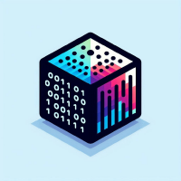</a>&nbsp;&nbsp;&nbsp;&nbsp;&nbsp;
<a href="https://www.nvidia.com/en-us/" title="NVIDIA; GB10 Grace Blackwell hardware">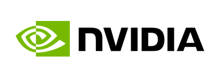</a>

<strong>Agents, automation &amp; data.</strong> Agent workflows, messaging, vector search, storage, and interfaces for local AI experiments.

&nbsp;&nbsp;&nbsp;&nbsp;&nbsp;
<a href="https://github.com/openlegion-ai/openlegion" title="OpenLegion">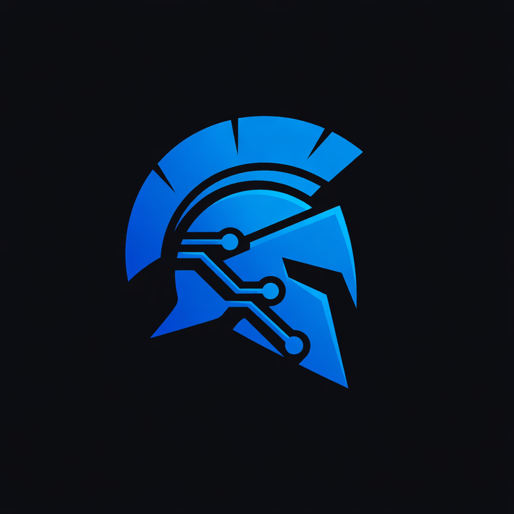</a>&nbsp;&nbsp;&nbsp;&nbsp;&nbsp;
&nbsp;&nbsp;&nbsp;&nbsp;&nbsp;
&nbsp;&nbsp;&nbsp;&nbsp;&nbsp;
<a href="https://qdrant.tech/" title="Qdrant">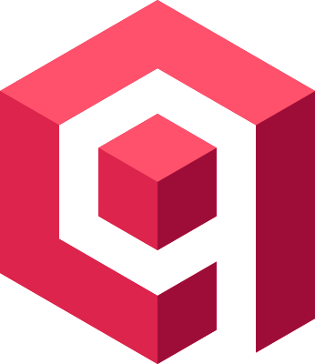</a>&nbsp;&nbsp;&nbsp;&nbsp;&nbsp;
&nbsp;&nbsp;&nbsp;&nbsp;&nbsp;
&nbsp;&nbsp;&nbsp;&nbsp;&nbsp;
&nbsp;&nbsp;&nbsp;&nbsp;&nbsp;
<a href="https://dify.ai/" title="Dify"><picture><source media="(prefers-color-scheme: dark)" srcset="assets/refined/dify-dark.png" /></picture></a>&nbsp;&nbsp;&nbsp;&nbsp;&nbsp;

<strong>Infrastructure &amp; security.</strong> Repeatable environments, service supervision, isolation, and security checks, including cgroups and pip-audit.

<a href="https://www.docker.com/" title="Docker">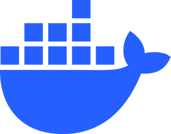</a>&nbsp;&nbsp;&nbsp;&nbsp;&nbsp;
<a href="https://github.com/docker/compose" title="Docker Compose">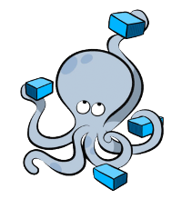</a>&nbsp;&nbsp;&nbsp;&nbsp;&nbsp;
<a href="https://www.ansible.com/" title="Ansible"><picture><source media="(prefers-color-scheme: dark)" srcset="assets/catalog/ansible.svg" /></picture></a>&nbsp;&nbsp;&nbsp;&nbsp;&nbsp;
&nbsp;&nbsp;&nbsp;&nbsp;&nbsp;
&nbsp;&nbsp;&nbsp;&nbsp;&nbsp;
<a href="https://github.com/anchore/syft" title="Syft; logo by Anchore, CC BY 4.0; logo by Anchore, CC BY 4.0: https://creativecommons.org/licenses/by/4.0/">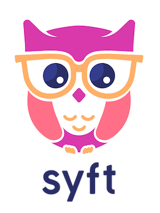</a>&nbsp;&nbsp;&nbsp;&nbsp;&nbsp;
<a href="https://github.com/gitleaks/gitleaks" title="Gitleaks">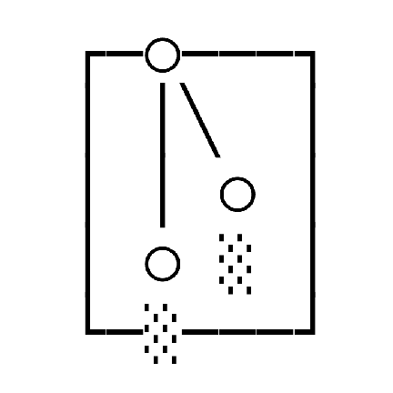</a>

<strong>Exploring.</strong> Paperclip and OpenShell are evaluation interests.

&nbsp;&nbsp;&nbsp;&nbsp;&nbsp;

<h2 id="security-and-reliability">Security and reliability</h2>

<ul>
<li><strong>Scope first.</strong> Explicit task boundaries and limited data/credential exposure.</li>
<li><strong>Verify changes.</strong> Tests and review before consequential changes.</li>
<li><strong>Keep work observable.</strong> Documented failure modes, reproducible setup, and recoverable changes.</li>
</ul>

Published test assets describe recorded runs; they do not guarantee current deployment health.

<a href="https://www.linkedin.com/in/orcunsener">Connect on LinkedIn</a>

